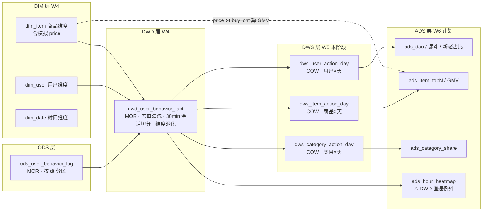

# 阶段 3（下）：湖仓分层建模（DWS 层主题宽表构建）— 操作过程汇报

| 项目 | 内容 |
|---|---|
| 阶段 | 阶段 3：湖仓分层建模（下） |
| 周次 | W5 |
| 姓名 / 学号 | 白梦辉 / 20232102540 |
| 指导教师 | 包萨日娜 |
| 日期 | 2026-10-22 |
| 对应开题 PPT | S9（五层数仓）· S18 甘特图「阶段 3 分层建模 · W5 进行中」 |
| 代码位置 | `D:\毕设\阶段3-脚本\stage3_dws_ddl.sql` · `stage3_dws_etl.py` · `stage3_dws_check.py` |
| 上游输入 | `dwd_user_behavior_fact`（W4 `stage3_dwd_etl.py` 产出：behavior_id / user_id / item_id / category_id / behavior_type / event_time / session_id / hour_of_day / dt 等） |
| 本阶段输出 | DWS 层 3 张主题宽表（Hudi COW）+ 聚合 ETL 脚本 + 数据血缘图谱 + 一致性校验报告 |

---

## 一、阶段目标与验收对照

**核心目标：** 基于 DWD 明细事实表，按「实体 × 天」粒度构建用户 / 商品 / 类目三大主题宽表，为 W6 ADS 指标计算提供唯一聚合来源；同时产出数据血缘图谱与汇总-明细一致性校验报告。

| 阶段交付物（任务书要求） | 本汇报对应章节 | 状态 |
|---|---|---|
| 1. DIM/DWD/DWS 各层建表 SQL 脚本 | 第三章（DWS 部分，DIM/DWD 见 W4 汇报） | ✅ |
| 2. 各层 ETL 计算脚本 | 第四章 `stage3_dws_etl.py` | ✅ |
| 3. 数据血缘关系图谱 | 第五章（分层血缘图 + 字段级血缘表） | ✅ |
| 4. 数据一致性校验报告 | 第六章 `stage3_dws_check.py` + 报告模板 | ✅ |

---

## 二、步骤 1：梳理业务主题与指标需求

### 2.1 三大分析主题

| 主题 | 分析对象 | 粒度 | 回答的业务问题 |
|---|---|---|---|
| 用户主题 | user_id | 用户 × 天 | 谁在活跃？活跃强度如何？是新增还是老客？会话行为质量如何？ |
| 商品主题 | item_id | 商品 × 天 | 哪些商品被看/被买得多？转化结构如何？ |
| 类目主题 | category_id | 类目 × 天 | 类目热度分布如何？流量向哪些类目集中？ |

### 2.2 指标需求 → 宽表来源映射（对齐开题 PPT 的 6 类大屏视图）

| 大屏视图 | 指标 | 计算方式 | DWS 来源表 |
|---|---|---|---|
| DAU 日活折线 | DAU | 按天 `count(*)`（宽表一行 = 一个当日活跃用户） | dws_user_action_day |
| GMV 成交数字卡 | GMV | `sum(buy_cnt × price)`，商品宽表 ⋈ dim_item | dws_item_action_day + dim_item |
| 转化漏斗 | pv→fav→cart→buy 转化率 | 各行为计数汇总后逐级相除 | dws_user_action_day（或商品/类目宽表） |
| 商品/类目排行 | Top-N 热销/热度 | `order by buy_cnt / action_cnt desc limit N` | dws_item_action_day、dws_category_action_day |
| 行为分布饼图 | pv/fav/cart/buy 占比 | 四类行为计数汇总占比 | 三张宽表任一（三角一致） |
| 新老用户占比（补充必做指标） | 新用户占比 | `sum(is_new_user) / count(*)` | dws_user_action_day |

### 2.3 指标口径声明（写入 W6《指标口径文档》的先决条款）

1. **GMV 口径**：天池 UserBehavior 数据集不含价格与订单金额，属于纯行为日志。本课题采用**模拟口径**：`dim_item.price` 为按类目均值生成的模拟单价，`GMV = Σ(buy 行为次数 × 模拟单价)`。论文与答辩中明确声明该口径为「行为 × 模拟价格 GMV」，用于验证链路与算法，不代表真实交易额。
2. **订单总量口径**：数据集无订单粒度，以 **buy 行为笔数近似订单量**（一笔 buy ≈ 一件成交）。
3. **客单价口径**：`客单价 = GMV / buy 独立用户数（buy_user_cnt）`，近似人均成交额。
4. **时段热力图的数据来源例外**：小时级热力需要 hour 粒度，DWS 保持「实体 × 天」粒度不膨胀。DWD 已含 `hour_of_day` 字段，故声明例外：**ads_hour_heatmap 允许从 DWD 明细按 hour 直接聚合**（明细 → ADS 直通，跳过 DWS），在血缘图谱中显式标注。备选方案：后续如需严格分层，可扩展第 4 张 `dws_user_action_hour` 表。

---

## 三、步骤 2：DWS 层宽表结构设计

### 3.0 总体设计原则

| 设计项 | 决策 | 理由 |
|---|---|---|
| 粒度 | 实体 × 天（一行 = 一个实体当天的行为汇总） | 与开题 PPT「实体×天聚合」一致，支撑日粒度指标 |
| 表类型 | **Hudi COW**（3 张全部） | 读多写少（每日批跑一次）、下游 ADS 高频查询，COW 读性能优；与 PPT「DIM/DWS/ADS 走 COW」一致 |
| 主键 | 实体 ID（user_id / item_id / category_id） | 分区 dt 内唯一，重跑幂等 |
| 分区 | dt（天） | 与 ODS/DWD 分区对齐，支持分区裁剪 |
| 预合并字段 | dt | 每日一批、同分区重跑值不变，保证「同 key 后写覆盖先写」 |
| 分层原则 | 只依赖 DWD 一层，不跨层引用；口径在 ADS 固化 | 唯一例外见 2.3 条款 4 |

建表 SQL 已落盘：`D:\毕设\阶段3-脚本\stage3_dws_ddl.sql`，核心结构如下。

### 3.1 用户主题宽表 `dws_user_action_day`

| 字段 | 类型 | 说明 |
|---|---|---|
| user_id | BIGINT | 主键 |
| pv_cnt / fav_cnt / cart_cnt / buy_cnt | BIGINT | 当日四类行为次数 |
| action_cnt | BIGINT | 当日总行为数（四类之和） |
| session_cnt | BIGINT | 当日会话数（distinct session_id，来自 W4 会话切分） |
| avg_session_actions | DOUBLE | 平均每会话行为数（衡量会话深度） |
| active_span_min | DOUBLE | 当日首末行为跨度（分钟，近似活跃时长） |
| first_action_time / last_action_time | TIMESTAMP | 当日首/末次行为时间 |
| is_new_user | INT | 1=当日为新用户首日（全历史 min(dt)=当日），0=老用户 |
| dt | STRING | 分区字段 |

```sql
CREATE TABLE IF NOT EXISTS dws_user_action_day (
    user_id             BIGINT    COMMENT '用户ID（主键）',
    pv_cnt              BIGINT    COMMENT '当日浏览次数',
    fav_cnt             BIGINT    COMMENT '当日收藏次数',
    cart_cnt            BIGINT    COMMENT '当日加购次数',
    buy_cnt             BIGINT    COMMENT '当日购买次数',
    action_cnt          BIGINT    COMMENT '当日总行为数（四类之和）',
    session_cnt         BIGINT    COMMENT '当日会话数（distinct session_id）',
    avg_session_actions DOUBLE    COMMENT '平均每会话行为数（会话深度）',
    active_span_min     DOUBLE    COMMENT '首末行为跨度（分钟，近似活跃时长）',
    first_action_time   TIMESTAMP COMMENT '当日首次行为时间',
    last_action_time    TIMESTAMP COMMENT '当日末次行为时间',
    is_new_user         INT       COMMENT '是否新用户首日（1是/0否）'
)
USING hudi
PARTITIONED BY (dt)
OPTIONS (
    type = 'cow',
    primaryKey = 'user_id',
    preCombineField = 'dt',
    hoodie.table.name = 'dws_user_action_day',
    hoodie.datasource.write.recordkey.field = 'user_id',
    hoodie.datasource.write.partitionpath.field = 'dt',
    hoodie.datasource.write.precombine.field = 'dt',
    hoodie.datasource.write.operation = 'upsert',
    hoodie.datasource.write.table.type = 'COPY_ON_WRITE',
    hoodie.cleaner.policy = 'KEEP_LATEST_COMMITS',
    hoodie.cleaner.commits.retained = 10
);
```

### 3.2 商品主题宽表 `dws_item_action_day`

| 字段 | 类型 | 说明 |
|---|---|---|
| item_id | BIGINT | 主键 |
| category_id | BIGINT | 所属类目（维度退化自 DWD） |
| pv_cnt / fav_cnt / cart_cnt / buy_cnt / action_cnt | BIGINT | 行为计数 |
| pv_user_cnt | BIGINT | 当日浏览该商品的独立用户数（曝光 UV） |
| buy_user_cnt | BIGINT | 当日购买该商品的独立用户数（W6 算客单价复用） |
| dt | STRING | 分区字段 |

### 3.3 类目主题宽表 `dws_category_action_day`

| 字段 | 类型 | 说明 |
|---|---|---|
| category_id | BIGINT | 主键 |
| pv_cnt / fav_cnt / cart_cnt / buy_cnt / action_cnt | BIGINT | 行为计数 |
| item_cnt | BIGINT | 当日有行为的商品数（类目动销宽度） |
| pv_user_cnt | BIGINT | 当日浏览该类目的独立用户数 |
| dt | STRING | 分区字段 |

> 3.2 / 3.3 的完整 DDL 见 `stage3_dws_ddl.sql`，风格与 W4 `stage3_dim_ddl.sql` 一致（USING hudi + OPTIONS）。

---

## 四、步骤 3：DWS 层聚合计算脚本

### 4.1 脚本说明

- 脚本：`D:\毕设\阶段3-脚本\stage3_dws_etl.py`
- 输入：DWD 明细（按 dt 分区裁剪）+ DWD 全历史（仅取 min(dt) 判定新老用户）
- 输出：3 张 DWS COW 宽表，upsert 写入 `~/hudi-bigdata/warehouse/`
- 幂等性：主键 = 实体 ID，预合并字段 = dt；同分区重跑时相同 key + 相同 precombine 值覆盖旧值 → **可安全重复执行**
- 运行模式：不带参数 = 有效日期分区全量回刷；`--dt 日期` = 只跑指定分区
- 数据量说明：约 104.86 万条 / 24 个有效日期分区（2017-09-11 ~ 2017-12-03；另 1 个异常时间戳分区 dt=2018-08-28 已于阶段 5 经 Hudi 事务 DELETE 剔除并备份），单日约 1 万 ~ 11 万条不等，shuffle 分区设 16 防止小文件过多

### 4.2 核心代码（完整文件见 `stage3_dws_etl.py`）

```python
# 单分区处理：聚合 -> 写入 -> 三角核对
def process_one(dt):
    # 分区裁剪读取 DWD 明细
    dwd_day = spark.sql(f"""
        SELECT behavior_id, user_id, item_id, category_id,
               behavior_type, event_time, session_id, dt
        FROM dwd_user_behavior_fact
        WHERE dt = '{dt}'
    """)

    # 1. 用户主题宽表：行为计数 + 会话质量 + 新老用户
    user_df = dwd_day.groupBy("user_id").agg(
        cnt("pv_cnt", "pv"), cnt("fav_cnt", "fav"),
        cnt("cart_cnt", "cart"), cnt("buy_cnt", "buy"),
        F.count("*").alias("action_cnt"),
        F.countDistinct("session_id").alias("session_cnt"),
        F.min("event_time").alias("first_action_time"),
        F.max("event_time").alias("last_action_time"))
    user_df = user_df \
        .withColumn("avg_session_actions",
                    F.round(F.col("action_cnt") / F.col("session_cnt"), 2)) \
        .withColumn("active_span_min",
                    F.round((F.unix_timestamp("last_action_time")
                             - F.unix_timestamp("first_action_time")) / 60.0, 1)) \
        .join(first_dt_df, "user_id", "left") \
        .withColumn("is_new_user",
                    F.when(F.col("dt") == F.col("first_dt"), 1).otherwise(0)) \
        .drop("first_dt").withColumn("dt", F.lit(dt))

    # 2. 商品主题宽表：行为计数 + 独立用户数
    item_df = dwd_day.groupBy("item_id").agg(
        cnt("pv_cnt", "pv"), cnt("fav_cnt", "fav"),
        cnt("cart_cnt", "cart"), cnt("buy_cnt", "buy"),
        F.count("*").alias("action_cnt"),
        F.max("category_id").alias("category_id"),
        F.countDistinct(F.when(F.col("behavior_type") == "pv",
                               F.col("user_id"))).alias("pv_user_cnt"),
        F.countDistinct(F.when(F.col("behavior_type") == "buy",
                               F.col("user_id"))).alias("buy_user_cnt")
    ).withColumn("dt", F.lit(dt))

    # 3. 类目主题宽表：行为计数 + 动销商品数
    cat_df = dwd_day.groupBy("category_id").agg(
        cnt("pv_cnt", "pv"), cnt("fav_cnt", "fav"),
        cnt("cart_cnt", "cart"), cnt("buy_cnt", "buy"),
        F.count("*").alias("action_cnt"),
        F.countDistinct("item_id").alias("item_cnt"),
        F.countDistinct(F.when(F.col("behavior_type") == "pv",
                               F.col("user_id"))).alias("pv_user_cnt")
    ).withColumn("dt", F.lit(dt))

    # 4. 写入 Hudi COW（预合并字段=dt，重跑幂等）
    write_hudi(user_df, "dws_user_action_day", "user_id")
    write_hudi(item_df, "dws_item_action_day", "item_id")
    write_hudi(cat_df, "dws_category_action_day", "category_id")

    # 5. 汇总-明细三角核对（明细 == Σ用户 == Σ商品 == Σ类目）
    ...

# 主流程：不带 --dt 时自动遍历全部日期分区
for dt in dt_list:
    process_one(dt)
```

### 4.3 执行与日志确认

部署到 WSL 并执行单日分区（与 stage2 的 spark-sql 调用模式一致）：

```bash
cp /mnt/d/毕设/阶段3-脚本/stage3_dws_etl.py ~/hudi-bigdata/scripts/
~/.local/bin/spark-submit --master local[2] \
  --jars ~/hudi-bigdata/jars/hudi-spark3.3-bundle_2.12-0.14.1.jar \
  --conf spark.sql.warehouse.dir=$HOME/hudi-bigdata/warehouse \
  --conf spark.sql.catalog.spark_catalog=org.apache.spark.sql.hudi.catalog.HoodieCatalog \
  --conf spark.serializer=org.apache.spark.serializer.KryoSerializer \
  --conf spark.sql.extensions=org.apache.spark.sql.hudi.HoodieSparkSessionExtension \
  ~/hudi-bigdata/scripts/stage3_dws_etl.py --dt 2017-11-25 2>&1 | tee ~/hudi-bigdata/logs/stage3_dws_etl.log
```

有效日期分区全量回刷（同上命令，去掉 `--dt` 参数即可）：

```bash
~/.local/bin/spark-submit --master local[2] \
  --jars ~/hudi-bigdata/jars/hudi-spark3.3-bundle_2.12-0.14.1.jar \
  --conf spark.sql.warehouse.dir=$HOME/hudi-bigdata/warehouse \
  --conf spark.sql.catalog.spark_catalog=org.apache.spark.sql.hudi.catalog.HoodieCatalog \
  --conf spark.serializer=org.apache.spark.serializer.KryoSerializer \
  --conf spark.sql.extensions=org.apache.spark.sql.hudi.HoodieSparkSessionExtension \
  ~/hudi-bigdata/scripts/stage3_dws_etl.py 2>&1 | tee ~/hudi-bigdata/logs/stage3_dws_etl.log
```

执行后核对三点（截图存档）：

1. 每个分区日志出现 `dt=xxxx 核对结论: ALL PASS`，且末尾「DWS 层总量预览」表按日输出 DAU 与四类行为总量；
2. 用户宽表行数 ≈ 当日 DAU；
3. Spark UI（4040 端口）job 全部 SUCCESS，无 shuffle spill 异常。

---

## 五、步骤 4：数据血缘关系图谱

### 5.1 分层血缘图



ASCII 简版（汇报 PPT / 论文可直接重绘）：

```text
ods_user_behavior_log ─┬─> dwd_user_behavior_fact ─┬─> dws_user_action_day ───> DAU/漏斗/新老占比
dim_user  ─────────────┤   (清洗·会话切分·退化)     ├─> dws_item_action_day ───> TopN / GMV(⋈dim_item.price)
dim_item  ─────────────┘                           └─> dws_category_action_day > 类目占比
                                                   (例外: dwd ──直通──> ads_hour_heatmap 时段热力)
```

### 5.2 字段级血缘（关键追溯关系）

| 目标字段（DWS） | 上游来源 | 加工逻辑 |
|---|---|---|
| dws_user_action_day.pv/fav/cart/buy_cnt | dwd.behavior_type | 条件计数 `count(when(type=...))` |
| dws_user_action_day.session_cnt | dwd.session_id（W4 会话切分产物） | `countDistinct(session_id)` |
| dws_user_action_day.is_new_user | dwd.dt 全历史 | `min(dt)==当前dt → 1` |
| dws_user_action_day.active_span_min | dwd.event_time | `(max-min)/60` 分钟 |
| dws_item_action_day.pv_user_cnt | dwd.user_id + behavior_type | `countDistinct(when(pv, user_id))` |
| dws_item_action_day.category_id | dwd.category_id | `max()` 随组携带（维度退化） |
| dws_category_action_day.item_cnt | dwd.item_id | `countDistinct(item_id)` 动销宽度 |
| （W6）ads GMV | dws_item.buy_cnt + dim_item.price | `sum(buy_cnt×price)` 模拟口径 |
| （W6）ads_hour_heatmap | dwd.hour_of_day | 按 hour×behavior_type 聚合（DWD 直通例外） |

血缘图谱结论：**每张 DWS 表只依赖 DWD 一层**（新用户判定复用 DWD 全历史，仍属同层依赖），无跨层引用；唯一 ADS 直通 DWD 的例外已显式声明。

---

## 六、步骤 5：汇总数据与明细数据的一致性校验

### 6.1 校验思路：三方三角核对

对每个 dt 分区，校验同一指标在多个口径下相等：

```text
核对 1：DWD 明细行数（按行为类型分计数）
       == Σ用户宽表对应列   == Σ商品宽表对应列   == Σ类目宽表对应列
核对 2：用户宽表行数 == 当日 DAU（distinct user_id）
核对 3：商品宽表行数 == 当日 distinct item_id；类目同理
核对 4：行内守恒 action_cnt = pv+fav+cart+buy（违例行数应为 0）
```

任何一项不等即判定分区校验失败，禁止下游 ADS 引用该分区。

### 6.2 校验脚本

脚本：`D:\毕设\阶段3-脚本\stage3_dws_check.py`（完整文件见脚本目录），核心逻辑：

```python
# 明细侧基准
base = dwd.agg(
    *[F.count(F.when(F.col("behavior_type") == t, 1)).alias(t)
      for t in ["pv", "fav", "cart", "buy"]],
    F.countDistinct("user_id").alias("uv"),
    F.countDistinct("item_id").alias("iv"),
    F.countDistinct("category_id").alias("cv")
).collect()[0].asDict()

# 汇总侧（三张宽表分别求和后与基准逐项核对，共 7 项）
for t in ["pv", "fav", "cart", "buy"]:
    check(f"{t} 明细==Σ用户宽表", base[t], su[f"{t}_cnt"])
    check(f"{t} 明细==Σ商品宽表", base[t], si[f"{t}_cnt"])
    check(f"{t} 明细==Σ类目宽表", base[t], sc[f"{t}_cnt"])
check("DAU == 用户宽表行数", base["uv"], du)
check("商品数 == 商品宽表行数", base["iv"], di)
check("类目数 == 类目宽表行数", base["cv"], dc)
check("行内守恒 action_cnt=四类之和(违例行数)", 0, bad_rows)
```

执行：

```bash
~/.local/bin/spark-submit --master local[2] \
  --jars ~/hudi-bigdata/jars/hudi-spark3.3-bundle_2.12-0.14.1.jar \
  --conf spark.sql.warehouse.dir=$HOME/hudi-bigdata/warehouse \
  --conf spark.sql.catalog.spark_catalog=org.apache.spark.sql.hudi.catalog.HoodieCatalog \
  --conf spark.serializer=org.apache.spark.serializer.KryoSerializer \
  --conf spark.sql.extensions=org.apache.spark.sql.hudi.HoodieSparkSessionExtension \
  ~/hudi-bigdata/scripts/stage3_dws_check.py --dt 2017-11-25
```

### 6.3 校验报告模板（填入实测值后归档）

《DWS 层数据一致性校验报告 — 2017-09-11 ~ 2017-12-03（24 个有效日期分区）》

示例分区 dt=2017-11-25 实测值（2026-10-22 执行）：

| 校验项 | 明细侧（DWD） | 汇总侧（DWS） | 差值 | 结论 |
|---|---|---|---|---|
| pv 总量 == Σ用户/商品/类目宽表 | 99,250 | 99,250 | 0 | PASS |
| fav 总量 == 三表求和 | 2,921 | 2,921 | 0 | PASS |
| cart 总量 == 三表求和 | 6,010 | 6,010 | 0 | PASS |
| buy 总量 == 三表求和 | 2,043 | 2,043 | 0 | PASS |
| DAU == 用户宽表行数 | 7,308 | 7,308 | 0 | PASS |
| 商品数 == 商品宽表行数 | 74,506 | 74,506 | 0 | PASS |
| 类目数 == 类目宽表行数 | 3,281 | 3,281 | 0 | PASS |
| 行内守恒 action_cnt = 四类之和 | — | 违例行 0 | 0 | PASS |

> 全部有效分区已逐日跑完 `stage3_dws_check.py --dt <日期>`（15 项核对全 PASS），ETL 内置三角核对亦全部「ALL PASS」，签注「DWS 分区可用」，W6 ADS 已引用。全链路总耗时约 66 分钟（串行）。异常分区 dt=2018-08-28 于阶段 5 剔除后经 dt=2017-12-03 抽验仍 ALL PASS。

---

## 七、阶段交付物清单

| # | 交付物 | 位置 / 形式 |
|---|---|---|
| 1 | DWS 层 3 张建表 SQL | `D:\毕设\阶段3-脚本\stage3_dws_ddl.sql` |
| 2 | 聚合 ETL 脚本 | `D:\毕设\阶段3-脚本\stage3_dws_etl.py` |
| 3 | 数据血缘关系图谱 | 本文档第五章（mermaid + ASCII 双版本） |
| 4 | 一致性校验脚本与报告 | `D:\毕设\阶段3-脚本\stage3_dws_check.py` + 第六章报告模板 |

附加产出：新老用户标记（`is_new_user`）、客单价前置字段（`buy_user_cnt`）、GMV 所需的类目冗余列——均提前覆盖 W6 ADS 必做指标（订单总量≈buy 笔数、客单价=GMV/buy_user_cnt、新老占比=Σis_new_user/DAU）。

---

## 八、踩坑与注意事项

1. **预合并字段选 dt 的原因**：DWS 每日一批、同分区重跑值不变，用 dt 作 precombine 保证「同 key 后写覆盖先写」即可，无需引入额外时间戳列。
2. **小文件控制**：`spark.sql.shuffle.partitions=16`；若出现单分区几十个小文件，追加 `hoodie.datasource.write.records.per.file` 控制。
3. **countDistinct 与 when 组合**：`countDistinct(when(cond, user_id))` 依赖 null 不计数特性，勿改写为 `countDistinct(when(cond, lit(1)))`（会把不满足条件的也计入）。
4. **时区一致性**：W2 已将 Unix 时间戳转为北京时间；DWS 的 first/last_action_time 与 DWD 保持同时区，避免 active_span 跨日异常。跨 0 点行为归属以 dt 分区为准（归入行为发生日）。
5. **behavior_type 值域**：W4 清洗已过滤为 pv/fav/cart/buy 四类，DWS 聚合无需重复校验。
6. **重跑安全性**：upsert + 相同 precombine 使同分区可重复执行；但跨 dt 重跑时注意 `--dt` 参数要改对，否则会写到错误分区。
7. **W6 直通例外已备好字段**：DWD 自带 `hour_of_day`（W4 产出），ads_hour_heatmap 可直接按 hour 聚合，无需改动 DWD。

---

## 九、下一步计划（W6：阶段 4 业务指标计算·上）

1. 编写《指标口径文档》——将 2.3 节 4 条口径声明正式化（GMV 模拟口径、订单≈buy、客单价、新用户定义），作为 ADS 建表的唯一依据；
2. 设计 5 张 ADS 指标表（COW）：ads_dau_trend / ads_funnel / ads_item_topN / ads_category_share / ads_hour_heatmap（hour 热力走 DWD 直通例外）；
3. 用 Spark SQL 从 DWS 三表出数，产出首个大屏联调数据集（DAU 折线 + GMV 数字卡）。

---

*汇报人：白梦辉（20232102540） · 阶段 3（下）· W5*
